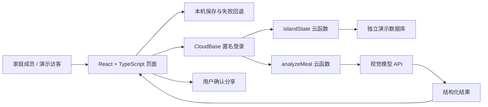

# 晴日岛 · Sunny Island

**把各自忙碌的一天，变成家人可以参与的一座小岛。**

晴日岛从真实家庭需求出发，把任务、日程、近况和餐食记录放在一个共同空间，让家人少一点反复询问，多一点自然回应。完成自己的小事，可以获得阳光，收藏小岛上的装饰。

最初的需求是帮助“想做事，但不容易开始和坚持”的孩子，后来扩展到分处不同地点的家庭成员。孩子安排自己的今天，成年人分享自己的生活，每个人都有参与空间。

> 本仓库是使用虚构家庭资料的独立公开演示版，保留完整前端、云同步与餐食 AI 云函数。**截至 2026-10-09：本地构建通过，新云环境尚未开通，线上同步和真实模型调用待部署验收。** 未配置后端时页面显示“本机预览，云端待配置”，不会用预置答案冒充 AI。


## 可以做什么

| 使用场景 | 页面和操作 | 解决的问题 |
| --- | --- | --- |
| 不知道今天先做什么 | 首页显示下一项安排；“我的今天”查看日程、完成任务、记录习惯 | 把模糊目标变成具体的下一步 |
| 课程和临时任务混在一起 | 家庭计划统一查看固定日程与待排任务，支持安排和调整 | 减少遗漏，让家人知道彼此何时方便 |
| 分处不同地点，只能反复问近况 | 主动更新状态，留下文字、照片和回应 | 用轻量、异步的交流维持联系 |
| 想记录饮食，又不想写很长一段 | 图片和文字交给 AI，先查看食物与搭配观察，再选择分享 | 降低记录成本，保留本人的决定权 |
| 做完一件小事，反馈很快消失 | 完成记录获得阳光，收藏装饰并查看阳光流水 | 把行动积累变成持续可见的反馈 |

## 三分钟体验

1. 首页查看虚构家人状态，进入“我的今天”，完成一项任务，观察阳光变化。
2. 在“家庭计划”查看固定课程和待排任务，在“阳光收藏”浏览小岛物件。
3. 切换姐姐或妈妈，留下一个生活片段，到“家人动态”查看。
4. 后端配置完成后，复制同岛链接，在另一台设备打开，验证日程与留言同步。
5. 模型配置完成后，使用不含个人信息的餐食照片体验分析；结果先展示给本人，确认后才分享。

新浏览器默认生成自己的演示空间，分享同岛链接才会访问同一份云端内容。持有链接的人可读写该空间；角色切换用于体验，不是正式账号权限系统。请只放虚构内容。

## 页面预览

| 我的今天 | 家庭计划 |
| --- | --- |
|  |  |

| 阳光收藏 | 家人动态 |
| --- | --- |
|  |  |

手机首页：[查看窄屏截图](docs/images/mobile-home.jpg)。截图来自本机演示，顶部如实标明后端待配置。

## 为什么这样设计

**先让人容易开始。** 首页突出下一步，奖励关联具体完成行为，不用复杂积分规则占据主要注意力。

**让家人都能参与。** 成年人也有自己的今日记录，状态、餐食与生活片段都能成为交流的起点。没有成绩排行榜和惩罚机制。

**把 AI 放在明确环节。** 图片与文字的餐食理解使用模型；日程、阳光计算和页面交互由应用规则实现。模型不替人自动发动态，用户检查后再分享。

**保留已经用起来的结构。** 本次沿用原项目五个页面、黏土小岛和核心操作，统一配色、卡片层级与移动端排版，修正日程时间显示问题。

具体需求、取舍及后续验证见 [产品说明](docs/product.md)。

## 如何实现



- 前端：React、TypeScript、Motion，公开版通过 Vite 构建静态资源，保留原应用组件。
- 三维场景：Three.js 加载小岛模型，通过同源消息同步展示状态，部分脚本依赖 CDN。
- 云同步：匿名登录后由云函数读写空间文档；6 秒轮询与窗口恢复刷新；版本号检查并发更新，冲突时提示。
- 餐食 AI：浏览器压缩图片，云函数实际调用支持视觉输入的 OpenAI 兼容接口。密钥仅放服务端，模型名称通过部署配置。
- 公开演示：独立环境、虚构数据、空间隔离、客户端数据库拒绝直接读写；模型每日调用次数默认关闭，配置后开放。

详细数据流和限制见 [技术说明](docs/architecture.md)。

## 本地运行

使用 Node.js 22 LTS：

```bash
npm install
npm run dev
```

打开 `http://127.0.0.1:4183/`。未配置 `.env.local` 时可体验本机任务、日程、动态和小岛；跨设备同步与 AI 需要独立云环境。

```bash
npm run build
node --test tests/policies.test.mjs
```

配置和逐项验收见 [部署指南](docs/deployment.md)。

## 项目经历与验证边界

作者根据家庭需求定义场景，通过与 AI 交互迭代功能、界面和实现，并亲自使用过跨设备日程、动态同步和餐食 AI。历史使用来自作者确认；原云资源已释放，本仓库不含原家庭数据，也无法恢复被删除的云数据。

本次整理保留原功能，替换私人资料，改进视觉，增加独立演示空间并整理云函数与文档。新环境部署成功前，历史使用与本次验收分开表述。

尚未开展大样本研究，也没有经验证的用户量、留存率或效率提升比例。下一步应观察任务开始与完成、家人回应、AI 误识别和多设备操作，再评估更广泛的家庭需求。

素材和第三方库说明见 [ATTRIBUTION.md](ATTRIBUTION.md)。
