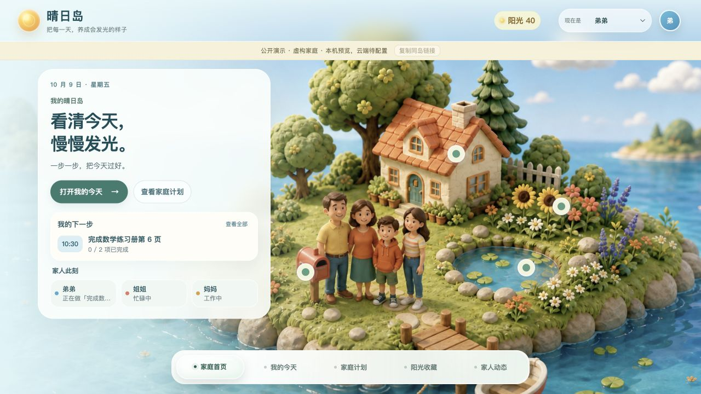
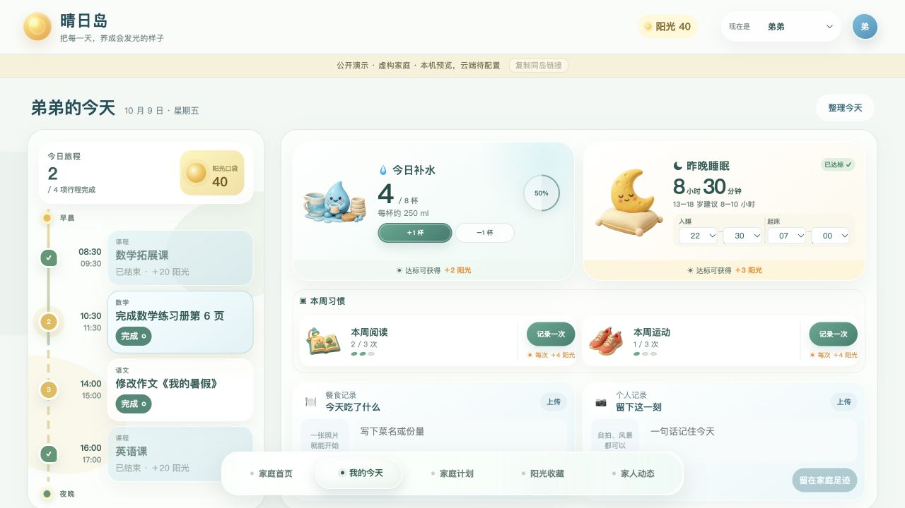
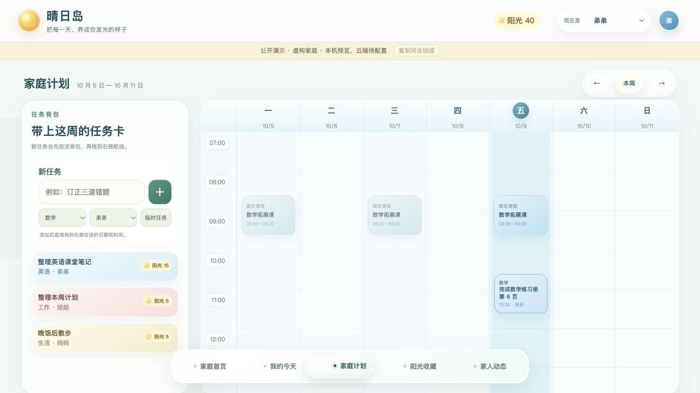
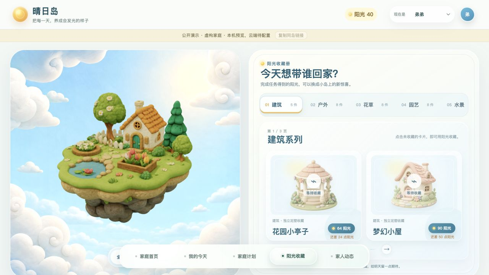
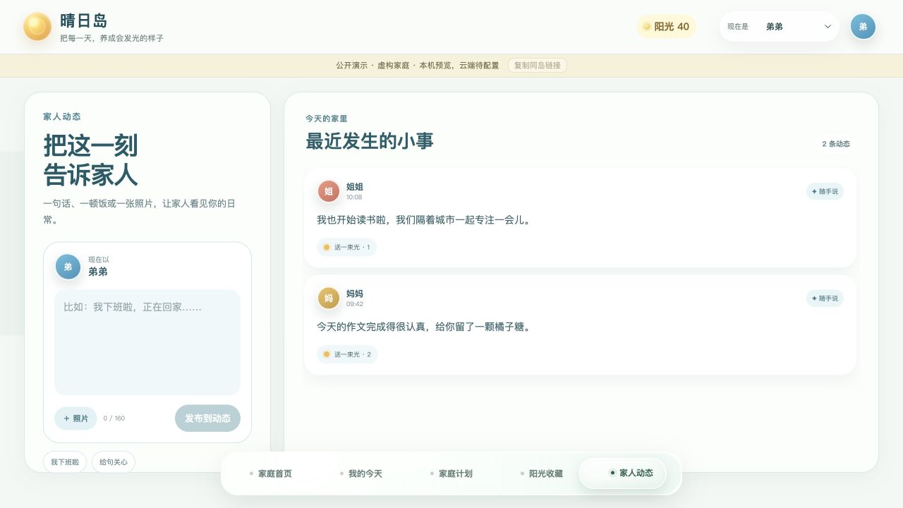
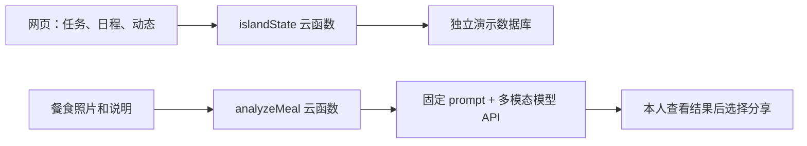

# 晴日岛 · Sunny Island

这是我给自己家里做的一个网页应用。最开始想解决的事情很具体：家人分散在不同地方，我和妈妈平时都要上班，没办法一直在旁边看着弟弟学习，也不太清楚他一天是怎么安排的。平时联系不多，聊天经常又只剩下问作业。

我想做一个我们都能打开的地方：帮弟弟把时间安排清楚，做完一件事能马上得到一点反馈；我和妈妈能看到他的安排，也能分享各自的生活。妈妈比较关心饮食，所以我后来又加了餐食记录和 AI 分析。

选择网页，是因为我们实际使用的设备。弟弟没有手机，主要用电脑；我和妈妈工作时也经常用电脑。打开一个链接就能用，比另装一个手机应用更合适。

[在线预览（本机保存）](https://yusi21-bot.github.io/sunny-island/) · [云端演示](https://sunny-island-demo-d9dc2x8f51ae43-1454815199.tcloudbaseapp.com/) · [餐食 AI 的接入说明](docs/meal-ai.md)

> 这里是替换了个人信息和家庭记录的演示版本。角色、课程、任务与动态均为虚构示例。公开版不开放付费模型调用，餐食照片和文字仍可直接记录、分享。云端演示使用腾讯云测试域名，首次访问可能需要确认平台提示。



## 弟弟怎么用，我们怎么参与

弟弟打开首页，可以先看今天下一件要做的事。到“我的今天”查看任务和课程，完成任务后获得阳光，再去小岛上收藏装饰。我希望这种即时反馈能帮他更容易开始做事，并慢慢养成自己安排时间的习惯；目前没有数据证明它已经改善了学习习惯。

“家庭计划”把固定课程、临时任务和待安排的事情放在一起。我和妈妈可以协助安排，也能了解他现在有哪些事、哪些已经完成。这样既方便督促，也给他自己规划和调整的空间。

但如果这里只有作业，弟弟可能不太愿意打开。所以我保留了家庭动态：我们也可以发照片、写近况、回应彼此。它既是学习安排的工具，也是我们在不同地方时能共同使用的一个小空间。

| 页面 | 可以做的事 |
| --- | --- |
| 家庭首页 | 看自己的下一项安排、家人状态，进入各个功能 |
| 我的今天 | 查看当天任务和课程、完成打卡、记录生活和餐食 |
| 家庭计划 | 查看一周安排，新增任务、调整时间与科目 |
| 阳光收藏 | 查看阳光记录，收藏装饰，浏览三维小岛 |
| 家人动态 | 发布文字和照片，查看、回应家人的近况 |

| 我的今天 | 家庭计划 |
| --- | --- |
|  |  |

| 阳光收藏 | 家人动态 |
| --- | --- |
|  |  |

截图来自本机演示；[手机窄屏截图](docs/images/mobile-home.jpg)。

## 为什么加餐食 AI

妈妈比较关心饮食。我设想的操作是：拍下一顿饭，补充菜名或份量，让 AI 看看有哪些食物、搭配中有什么可以保留、下一顿可以怎样补充。结果先给本人看，再决定是否分享给家人。

照片不能准确告诉我们用了多少油盐、每种食物的重量，也不能据此判断身体状况。所以这里的目标是帮助记录和给出简单的搭配建议，不是精确计算营养或判断疾病。

原来自己家里用的版本接过多模态模型，我实际用过餐食分析。这次公开展示不开放我的付费 API 额度：隐藏密钥只能防止别人直接拿走密钥，不能防止公开入口被反复调用。仓库保留了云函数和固定 prompt，想自己部署的人可以接自己的模型服务。

- 固定指令：[cloudfunctions/analyzeMeal/prompt.js](cloudfunctions/analyzeMeal/prompt.js)
- 后台调用：[cloudfunctions/analyzeMeal/index.js](cloudfunctions/analyzeMeal/index.js)
- 密钥放哪里、怎样改 prompt、以后怎样启用：[餐食 AI 接入说明](docs/meal-ai.md)

## 我是怎样做出来的

我先提出家里的使用需求，再通过和 AI 反复讨论、生成代码、实际试用，逐步调整页面和功能。原来家里使用时，我能看到弟弟在另一台设备更新的日程和动态，也试过餐食 AI。原云资源后来被释放，旧云端数据无法恢复。

这次整理成独立项目时，我保留了原来的五个页面和主要功能，替换私人信息，调整配色、文字层级和移动端排版，修正时间显示问题，并重新准备了独立演示后端。历史使用情况和这次重新部署的验收分开记录，不把代码上传等同于功能验证通过。

前端用 React、TypeScript 和 Vite，三维小岛用 Three.js。数据先保存在本机；云端版本通过 CloudBase 匿名登录和云函数读写数据库。不同访客默认使用不同空间，复制“同岛链接”后，另一台设备才会进入同一个空间。链接持有人可以读写这个空间，角色切换只是演示功能，不是家庭成员的权限认证。



图中的模型调用路径保留在代码中，公开演示不启用。

## 运行与部署

Node.js 22 LTS：

```bash
npm ci
npm run dev
```

默认地址 `http://127.0.0.1:4183/`。不配置环境变量时，任务、日程和动态使用本机存储。构建与检查：

```bash
npm run build
node --test tests/policies.test.mjs
```

[部署说明与当前状态](docs/deployment.md) · [验证记录](docs/verification.md) · [技术说明](docs/architecture.md) · [产品设计记录](docs/product.md)

目前仍是从自家需求出发的小项目，没有验证过更多家庭是否会持续使用，也没有用户规模、留存或学习效果方面的数据。下一步更值得观察的是：弟弟是否愿意自己安排任务，家人是否真的更常回应彼此，而不只是页面有没有做完。

素材及第三方库说明见 [ATTRIBUTION.md](ATTRIBUTION.md)。
